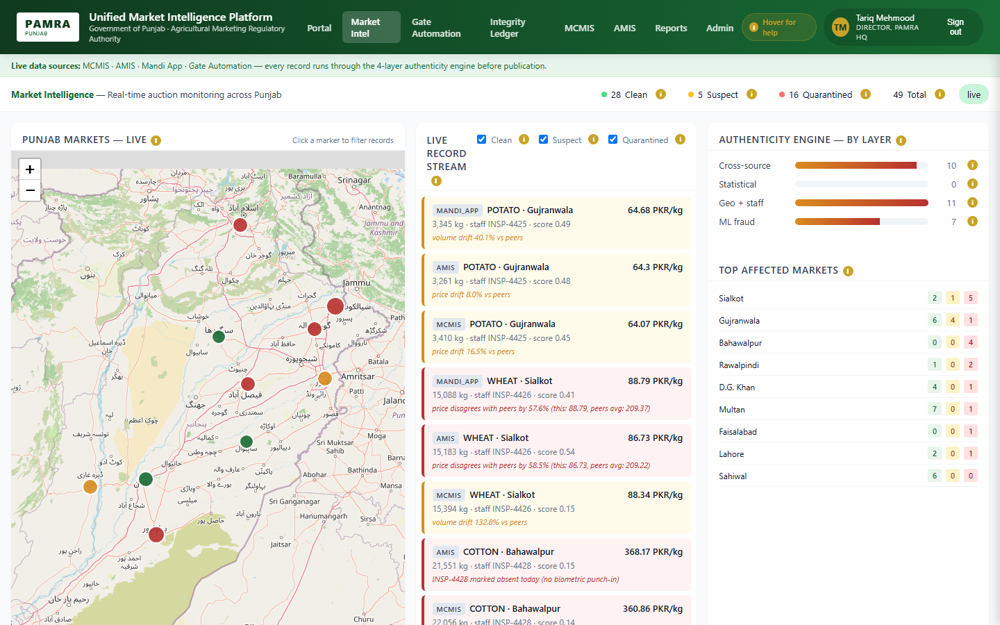
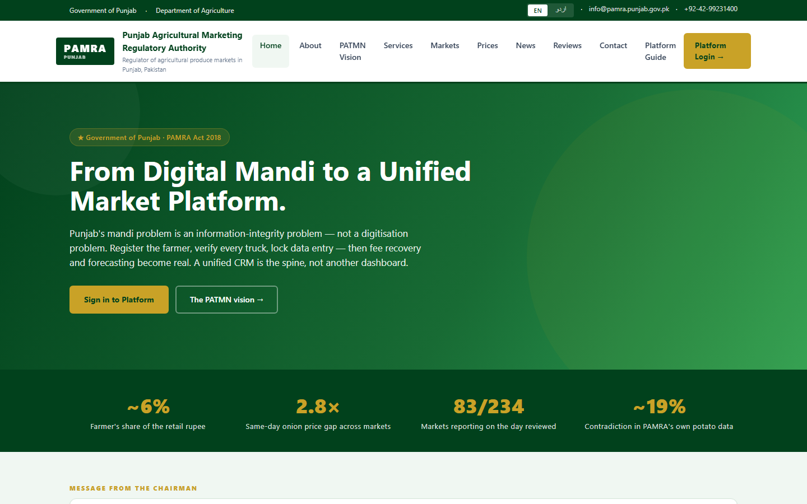
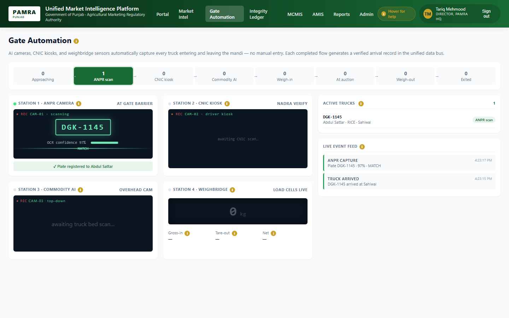
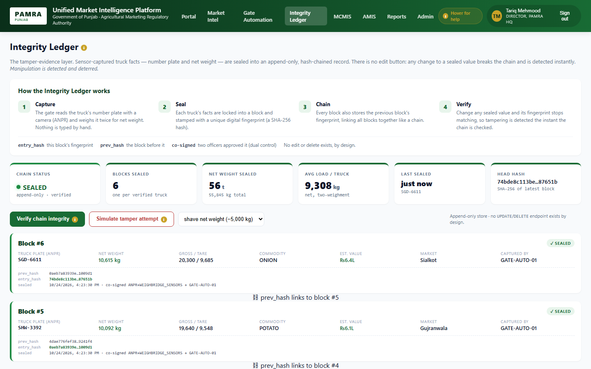
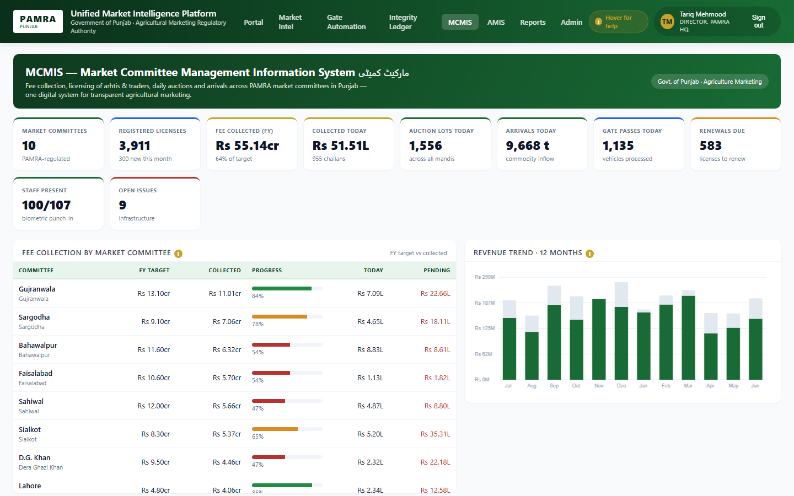
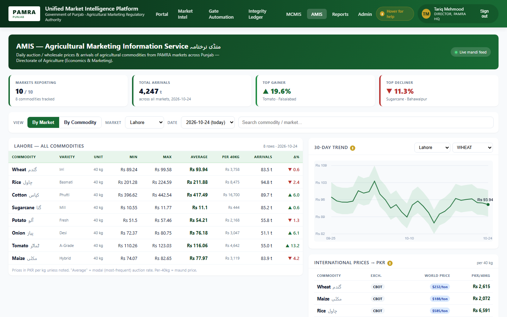

# Unified market intelligence platform for PAMRA

A proposal and working prototype for the Punjab Agricultural Marketing Regulatory Authority
(PAMRA), whose three systems (MCMIS for market committees, AMIS for daily prices, and the Mandi
auction app) do not agree with each other and cannot tell a real record from a fabricated one. The
prototype joins all three into one platform behind a public website: every incoming record passes
through a four-layer authenticity engine before it is published, and every truck through a mandi
gate is sealed into a hash-chained ledger. It runs as a Node server locally and as a fully static
site on Vercel.

I wrote the proposal and built the whole prototype: the public PAMRA website in English and Urdu,
the staff platform with its seven modules, the simulators for the three source systems, the
authenticity engine, the integrity ledger, staff authentication, the Supabase-backed reviews page,
and the browser bundle that lets the entire backend run inside the page so it can be hosted
without a server.



## What it does

**For the public**
- A PAMRA website: home, about, mission, chairman's message, the PATMN vision, services, a market
  directory with coordinates and hours, today's commodity prices, news, tenders, careers, contact,
  a platform guide and a reviews page, with an English / Urdu toggle
- Live public API for markets, today's prices and news, with internal fields stripped

**For PAMRA staff, inspectors, analysts and committee secretaries**
- Market Intelligence: a live map of Punjab markets, a streaming record feed tagged Clean, Suspect
  or Quarantined with the reason, engine results by layer, and the most affected markets
- Gate Automation: the eight-station flow of a truck through a mandi (ANPR camera, CNIC kiosk,
  commodity AI, weigh-in, auction, weigh-out, exit) with a live event feed
- Integrity Ledger: sealed truck facts, chain status, a verify button and a "simulate tamper"
  button that shows the chain breaking
- MCMIS: fee collection by market committee against FY targets, licensees, auctions, arrivals,
  gate passes, staff present, a 12-month revenue trend
- AMIS: prices by market or by commodity, 30-day trends, international prices converted to PKR
- Reports and Admin: KPI tiles, cold-storage and P&L charts, users, traders, adapter status
- Four demo roles (admin, inspector, analyst, committee) each see the modules they are allowed

## The authenticity engine

Every record from MCMIS, AMIS or the Mandi App is evaluated by four layers before publication:

- **Cross-source validation** compares the same transaction across systems
- **Statistical anomaly detection** flags prices and volumes that drift from their peers
- **Geo and staff verification** rejects entries from staff with no biometric punch-in or outside
  the market's geofence
- **Fraud scoring** combines the signals into one score

Disposition is explicit: any failed layer or a score above 0.70 is **Quarantined** and withheld
from analytics; a warning or a score above 0.40 is **Suspect** (published but flagged); otherwise
**Clean**. The simulator emits a batch every 1.5 seconds and plants a bad record in about a quarter
of them (price manipulation, ghost arrival, geofence violation, outlier, cross-source mismatch,
absent-staff entry), and each record's audit drawer shows the per-layer verdict beside the
ground-truth label.

## The integrity ledger

Sensor-captured facts for each truck (plate, gross and tare weight, net weight, commodity, market)
are written to an append-only store. Each block carries a SHA-256 of its contents and the hash of
the block before it, and is co-signed by the gate sensors and the gate officer. There is no update
or delete endpoint by design; changing any sealed value breaks the chain on the next verify.

## Two ways to run it

- **Server mode:** `server.js` serves the pages, the public and authenticated APIs, and pushes
  records to the dashboard over a WebSocket
- **Static mode:** `build-bundle.js` bundles `src/` into `public/pamra-backend.js`;
  `web/runtime.js` runs the same simulators and engine in the browser, overrides `fetch` for
  `/api/*` and replaces the WebSocket with a pub/sub bus, so every page works unchanged on Vercel.
  State is per page in this mode, which is fine for a demo

## Stack

| Layer | Choice |
|---|---|
| Server | Node.js 18+, Express 4, `ws` |
| Engine and data | Plain CommonJS modules in `src/engine` and `src/data` |
| Front end | Static HTML, CSS and JavaScript per page, Leaflet map, shared header and i18n |
| Reviews | Supabase Postgres over its REST API with row-level security |
| Hosting | Vercel (static build), `vercel.json` with clean URLs and `/` rewritten to the homepage |

## Engineering

- **One source of truth:** `src/` is used by both the Express server and the browser bundle, so
  the engine cannot drift between the two deployments
- **Explicit disposition rules** and planted tamper cases make the engine's behaviour testable by
  eye in the live feed
- **Row-level security** on the reviews table so the public anon key can only read approved
  reviews and insert new ones

## Screenshots

| | |
|---|---|
|  |  |
| The public PAMRA website | Gate Automation: a truck mid-flow at the ANPR station |
|  |  |
| Integrity Ledger with six sealed blocks | MCMIS: fee collection by market committee |
|  | |
| AMIS: today's prices in Lahore and a 30-day trend | |

Screenshots show the prototype running locally in server mode, signed in as the demo admin; all
market data is generated by the built-in simulators.

## Running it locally

```
cd pamra/pamra/pamra
npm install
npm start                    # http://localhost:3000  (Express + WebSocket)
npm run build                # static build: src/ -> public/pamra-backend.js
# demo accounts: admin/admin123  inspector/insp123  analyst/analyst123  committee/comm123
```

The reviews page needs a Supabase project; the setup SQL and the keys to put in
`public/supabase-config.js` are described in `SUPABASE_SETUP.md`. The proposal itself is
`PROPOSAL.md`.

## Links

- Vercel project `pamra` (linked in `.vercel/project.json`)

## Repository notes

Canonical code is `pamra/pamra/pamra/`; `pamra.zip` is an archive of the same tree and
`pamra/__MACOSX/` is macOS archive metadata. `pamra/pamra/pamra/.git-history/` is the original
nested git metadata preserved as plain files.
